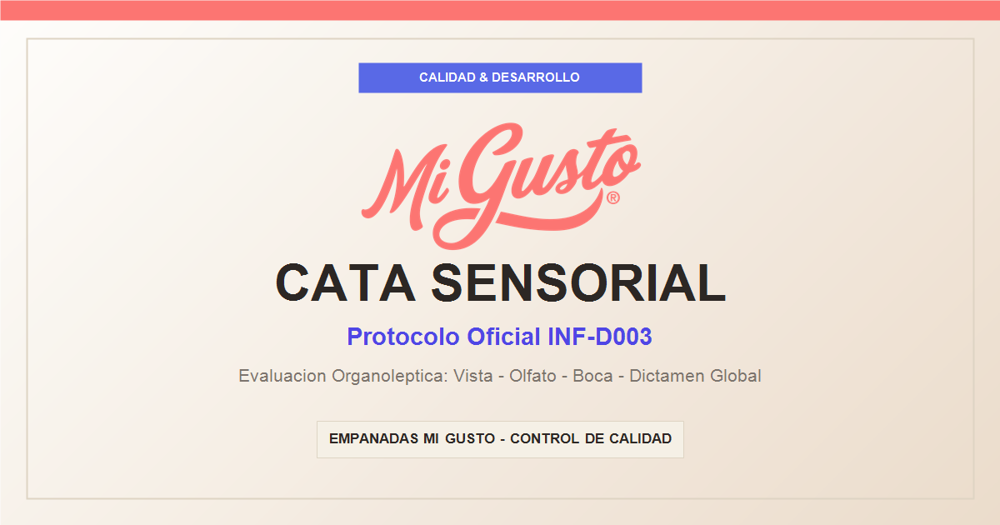
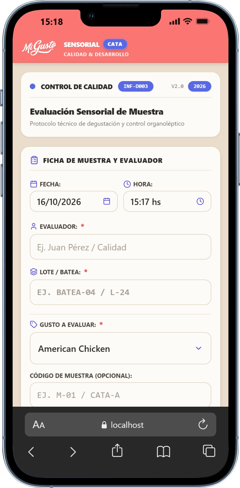
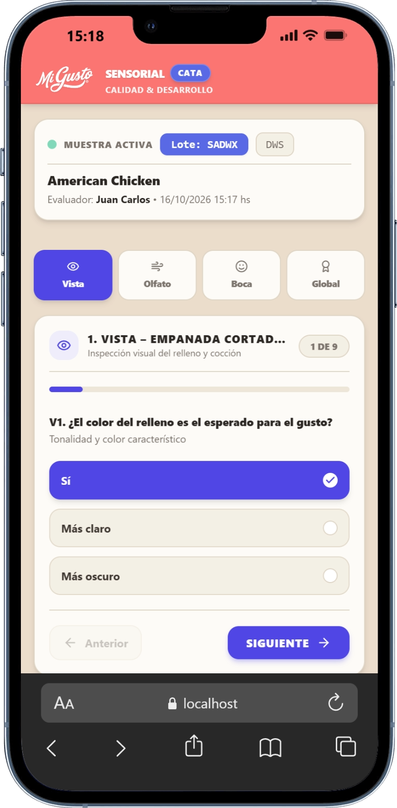
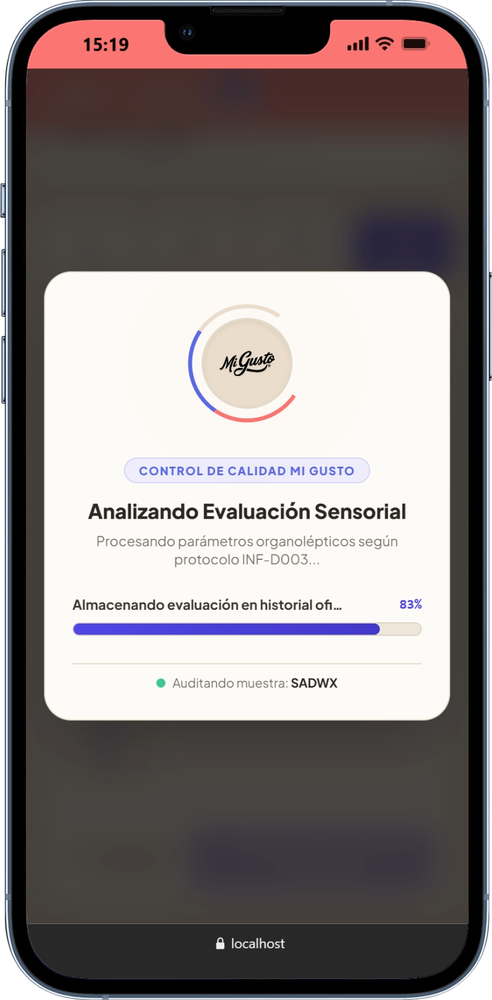
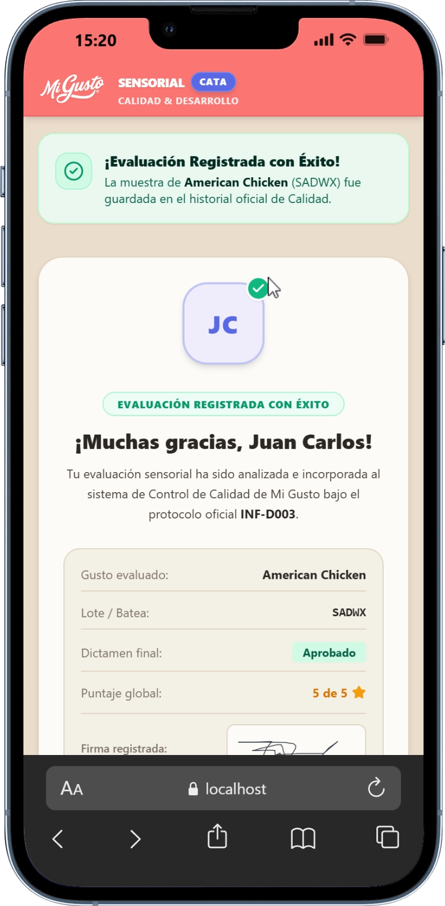
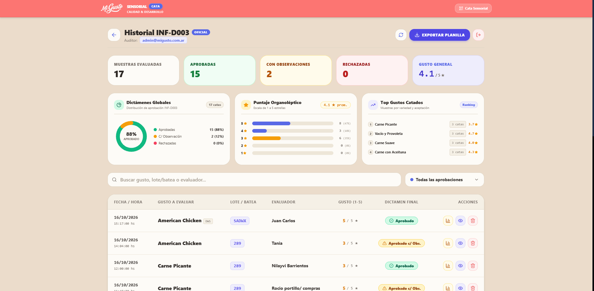
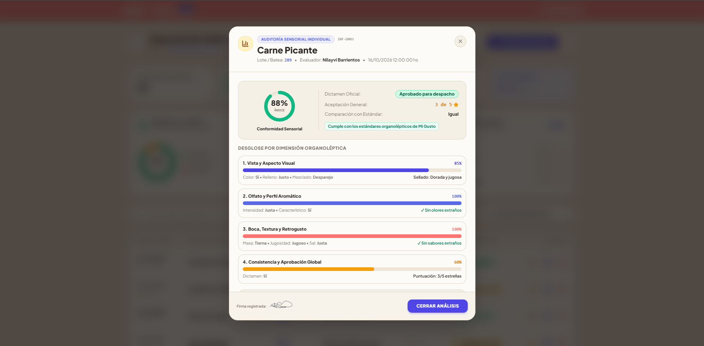
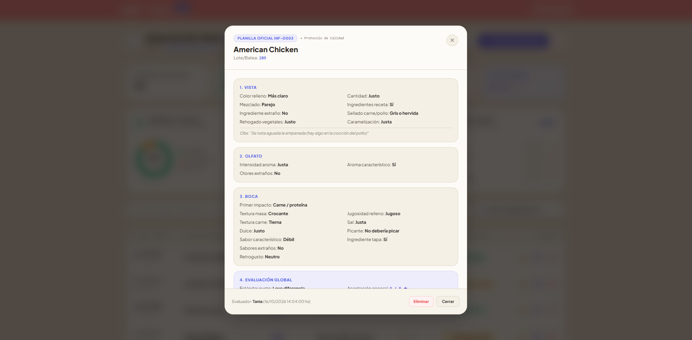

  

  # 🥟 Mi Gusto — Sistema de Evaluación Sensorial

  **Plataforma Integral de Control de Calidad Organoléptico y Auditoría Técnica**  
  *Estandarización y aseguramiento de calidad gastronómica bajo Protocolo Oficial INF-D003*

   

  
  
  
  
  
  

---

## 📋 Visión General

**Mi Gusto Sensorial** es una solución digital avanzada diseñada específicamente para el departamento de **Calidad & Desarrollo**. Su objetivo primordial es digitalizar, agilizar y parametrizar los testeos de degustación y control sensorial en planta y laboratorio, garantizando que cada lote elaborado cumpla con los más rigurosos estándares antes de su distribución.

A través de un flujo estructurado de auditoría en cuatro dimensiones organolépticas clave y un panel administrativo con métricas en tiempo real, el sistema elimina planillas manuales, unifica criterios de aceptación y provee trazabilidad integral por evaluador, lote y variedad.

---

## ✨ Características Principales

### 🔬 Evaluación Sensorial por Etapas (Protocolo INF-D003)
- **Ficha de Muestra y Evaluador**: Registro con fecha (`dd/mm/aaaa`), hora automática, identificador de batea/lote, variedad a catar y código facultativo.
- **Dimensión 1 — Vista y Aspecto Visual**: Control de tonalidad del relleno (esperado, más claro, más oscuro), homogeneidad del mezclado, cocción y sellado (dorado, gris/hervida).
- **Dimensión 2 — Olfato y Perfil Aromático**: Detección de intensidad aromática, aromas característicos de receta y chequeo de desvíos u olores extraños.
- **Dimensión 3 — Boca, Textura y Retrogusto**: Análisis de textura de masa (crocante, gomosa, blanda), ternura del relleno, nivel de jugosidad, balance de sal, dulzor, picor y retrogusto limpio.
- **Dimensión 4 — Dictamen y Aprobación Global**: Calificación en escala hedónica de 1 a 5 estrellas, dictamen oficial (*Aprobado*, *Aprobado con observaciones*, *Rechazado*) y justificación técnica.

### ✍️ Firma Digitalizada en Canvas
- Módulo interactivo con captura de firma táctil y de cursor con soporte de alta densidad de píxeles (`Retina / HiDPI`).
- Validación obligatoria de rúbrica para garantizar la validez legal y de auditoría interna de la muestra.

### 📊 Panel de Administración y Métricas en Tiempo Real
- **KPIs Directos**: Conteo instantáneo de muestras evaluadas, aprobadas para despacho, con observaciones y rechazadas.
- **Distribución de Dictámenes**: Gráfico donut interactivo animado que ilustra porcentajes y proporciones de aceptación.
- **Score Organoléptico**: Promedio ponderado de estrellas y distribución porcentual del puntaje hedónico.
- **Ranking de Variedades**: Monitoreo de las recetas más catadas y su respectivo puntaje histórico.
- **Filtrado Dinámico y Búsqueda Multicriterio**: Filtrado instantáneo por texto (evaluador, lote, gusto) y selector por estado de aprobación.
- **Auditoría Individual Detallada**: Modal de inspección profunda con cálculo de índice porcentual de conformidad sensorial y desglose analítico de cada dimensión evaluada.
- **Exportación Técnica**: Descarga instantánea de planillas oficiales consolidadas en formato `.xlsx` con todas las variables organolépticas registradas.

### 🎨 Experiencia Visual y Micro-Animaciones GSAP
- **Diseño Gourmet Mi Gusto**: Paleta cálida y refinada basada en beige natural (`#fdfbf7`), rojo coral institucional y acentos tonales de estado.
- **Transiciones GSAP**: Conteo fluido de números, barras de progreso reactivas, gauges circulares dinámicos y modales con apertura y cierre amortiguado.
- **Comportamiento Responsivo**: Experiencia ergonómica adaptada para tablets de planta, terminales móviles de inspección y pantallas de escritorio.

---

## 🖼️ Galería de la Plataforma

  <table>
    <tr>
      <td width="50%" align="center">
        <b>Ficha de Muestra y Evaluador</b> 
        
      </td>
      <td width="50%" align="center">
        <b>Evaluación Organoléptica por Pasos</b> 
        
      </td>
    </tr>
    <tr>
      <td width="50%" align="center">
        <b>Análisis y Procesamiento Sensorial</b> 
        
      </td>
      <td width="50%" align="center">
        <b>Confirmación y Registro de Auditoría</b> 
        
      </td>
    </tr>
    <tr>
      <td width="50%" align="center">
        <b>Panel de Control y Métricas Globales</b> 
        
      </td>
      <td width="50%" align="center">
        <b>Auditoría Sensorial Individual y Desglose</b> 
        
      </td>
    </tr>
    <tr>
      <td colspan="2" align="center">
        <b>Planilla Técnica Completa de Auditoría (INF-D003)</b> 
        
      </td>
    </tr>
  </table>

---

## 🛠️ Tecnologías Clave

- **Frontend Core**: [React 18](https://react.dev/) + [TypeScript](https://www.typescriptlang.org/) para un tipado estricto y seguro en todas las variables técnicas.
- **Herramienta de Construcción**: [Vite](https://vitejs.dev/) con compilación ultrarrápida y recarga en caliente de módulos (HMR).
- **Estilos & Diseño**: [Tailwind CSS](https://tailwindcss.com/) configurado con la paleta de colores corporativa y tipografía moderna.
- **Animaciones**: [GreenSock Animation Platform (GSAP)](https://greensock.com/gsap/) para interpolación de gauges radiales, barras de progreso y modales fluidos.
- **Capa de Persistencia**: [Supabase](https://supabase.com/) (PostgreSQL en tiempo real) con clientes tipados y políticas seguras de acceso a datos.
- **Iconografía**: [Lucide React](https://lucide.dev/) para interfaces limpias y minimalistas.
- **Exportación de Datos**: [SheetJS (XLSX)](https://sheetjs.com/) para generación de planillas técnicas de control de calidad.

---

  Desarrollado para <b>Mi Gusto — Calidad & Desarrollo</b> • Protocolo Oficial de Calidad Sensorial INF-D003

